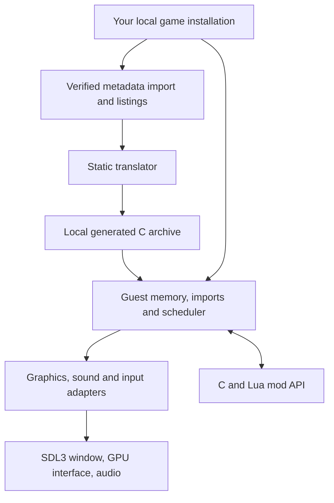

# Architecture

The build translates the supported executable's x86 instructions into C, then
compiles that C alongside a handwritten native runtime. At runtime the executable
supplies the original data image; its machine instructions are not executed by an
x86 emulator. The loader verifies its hash before mapping any of it.

## Guest memory and calls

`runtime/memory.cpp` owns the guest address arena and allocator. Guest pointers
remain 32-bit offsets even in a 64-bit process. `loader.cpp` maps PE sections,
zero-fills data tails and replaces import-table entries with runtime trampolines.
`imports.cpp` decodes calls and dispatches the original calling conventions.

`runtime/x86.h` defines the register file, flags, x87 state and
instruction helpers used by generated functions. The x87 is exact: its section
of `x86.h` explains the double fast path and when `runtime/x87.c` takes over
with 80-bit SoftFloat arithmetic. Functions retain stable guest
addresses for dispatch, hooks and diagnostics. Those addresses are identifiers,
not host pointers and not evidence of human-recovered intent.

A game that ships part of its code as a DLL can name it in game.toml as an
auxiliary module (`[modules.aux.<key>]`). The loader maps it beside the image
at its configured base, above the shim trampolines, so `[game] guest_size`
grows the arena to hold it. When that base is not the DLL's preferred one,
the loader applies the PE's base relocations and the translator applies the
same relocations to the image and listings it reads, so the translation and
the mapped bytes agree on every address. Every module is mapped before any
import table is bound: an executable importing from its DLLs, and DLLs
importing from each other, bind straight to the exports. The translator turns
the module into its own generated library with prefixed tables that register
with the runtime at start-up; `recomp_call` and `recomp_jump` consult that
registry after the image's own table misses, so calls in either direction
cross the boundary without a special case. `run_entry` attaches static
imports in dependency order before the entry point; `LoadLibrary` of the
module's name (with any path) loads its dependencies and runs its DllMain,
and `GetProcAddress` reads its export directory, which is all the game sees.

The translator moves the Ghidra listings (exported at the preferred base,
or at the base a function database names) by the same delta, rewriting
exactly the operand field - displacement or immediate - each relocation
covers, and every direct branch target.

A game that has classified its binaries can make that classification
authoritative with `function_db` (`translate.py` `FunctionDB`, schema
`recomp-funcdb/1`): code ranges instead of section flags, every function start
and alternate entry seeded, data inside code kept out of every scan, excluded
regions never translated, and no speculative pointer scan at all. The
translation report's `function_db` section lists what exact branch following
found that the database lacks.

## Freestanding bundles

`tools/build.py --target bundles` (`tools/recomp/bundle.py`) compiles every
translated module with `-ffreestanding -nostdinc` and `RECOMP_FREESTANDING`
(`runtime/freestanding.h`: compiler builtins, plus `recomp_libm_*` runtime
entry points for the library math) and links each with `ld64.lld -bundle
-undefined dynamic_lookup` into `build/recomp/bundles/<key>.bundle`. No SDK
header or library stub is involved, so an LLVM toolchain alone builds them. A
host `dlopen()`s the bundles instead of linking the generated archives: every
table, the image's included, registers itself as a `RecompModule`, and the
runtime's weak `recomp_call`/`recomp_jump` (`runtime/dispatch.cpp`) dispatch
through the registry. A bundle may ask the host only for runtime entry points,
`memcpy`/`memmove`/`memset`/`memcmp` and `setjmp`; `bundle.py` fails the build
otherwise.

## Threads and ownership

Original game threads are scheduled by `runtime/kernel32.cpp`. Each has a
register file, a guest stack and its own host thread, but **one guest thread
holds the execution baton at a time**. Host workers never mutate guest memory
concurrently with that thread. Nothing in the guest arena, the shims or the
generated code needs a lock: there is never more than one guest instruction in
flight.

### The scheduler

The baton moves at scheduling points, with the thread that holds it as the
only one that decides:

- **A blocking import** - a wait that cannot be satisfied yet, `Sleep`,
  `EnterCriticalSection` on a section another thread owns - parks its thread
  and hands the baton on.
- **Every import call** is a checkpoint. It costs a clock read; the lock is
  taken only when there is something to decide: the quantum is up, a timed
  wait is due, or a thread that outranks the holder has become ready.
- **A preemption point in translated code.** The translator puts
  `RECOMP_SAFEPOINT` (`runtime/x86.h`) at every function entry and loop head.
  A ticker host thread raises `recomp_sched_pending` every half quantum, and
  any thread made ready that outranks the holder raises it at once; the point
  then makes the same decision as a checkpoint. A point acts only where
  nothing but guest code is on the thread's stack (no shim callback, no mod
  hook, no atomic stretch), so a callback keeps exactly the scheduling points
  it had. Clear, a point is a load and a branch not taken.

Who runs next follows Windows' rules for one processor. A ready thread's class
is the priority Windows would give it in a process of normal priority class
(8 + `THREAD_PRIORITY_*` offset; 15 for time-critical); the higher class runs,
and within a class the thread that became ready first. A thread whose wait is
satisfied (an event, a semaphore, a socket) is boosted by one, and the run
thread by two when host input arrives for it, until it blocks again or uses a
quantum; a timeout (a `Sleep` over) and a critical section boost nothing. A thread kept ready
for 20 ms is raised to 15 for one quantum, so a busy high-priority thread
cannot shut the others out for long. The holder yields when a ready thread
outranks it, or at the end of its quantum (2 ms) to a ready thread of its own
class; a preempted thread keeps what was left of its quantum. `RECOMP_SCHED_POLICY=rr` restores the round robin by thread index with
a 1 ms slice that came before, for bisection; `RECOMP_SCHED_QUANTUM_MS`,
`RECOMP_SCHED_STARVE_MS`, `RECOMP_SCHED_SPIN_US` and `RECOMP_SCHED_SLEEP_BOOST`
tune the policy.

A handoff wakes only the thread it names: each thread sleeps on its own
condition variable. A thread that gave the baton up while it can still run
spins on an atomic hint for up to 50 us first, because the thread it gave way
to often hands it straight back (the run thread under a windowed host polls
its events instead). A waiter's object is taken when the change
that satisfies it is made (`SetEvent`, `ReleaseSemaphore`, `ReleaseMutex`
evaluate the waits there and then, as Windows does). Leaving a critical section
never gives the baton up and does not hand the section over: its waiter takes
it at the next scheduling pass in which it is free, so a loop of Enter and
Leave keeps it, as on Windows. Guest threads run at the user-interactive QoS class, so macOS
neither puts the holder on an efficiency core nor behind a build.

`RECOMP_SCHED_TRACE=FILE` (`runtime/sched_trace.h`) reports, per thread and per
window (`RECOMP_SCHED_TRACE_EVERY`, 10 s): the time it held the baton, how long
it waited for it while it could run, why it gave it up, the longest stretch
without a scheduling point, the cost of a handoff, the time nothing could run
and the latency of a mouse press from the host's event to the guest's first
read of it. `RECOMP_SCHED_TRACE_LONG_MS=N` also writes every hold and every
wait longer than N ms as it happens, a wait with the holds that filled it. A
game can name its threads and add its own lines (`sched_set_thread_namer`,
`sched_set_trace_reporter`).

The presentation worker consumes completed immutable frames. GPU resources and
texture revisions remain alive until commands that reference them complete.
Audio queues use their own clock and synchronization. Window events publish
requests for the guest thread rather than directly executing guest functions.

## A frame through the host

1. The original game submits DirectDraw/Direct3D operations to `dx/`.
2. `host/d3d_render.cpp` translates draws and texture revisions into GPU commands over `host/gpu/gpu.h`.
3. `host/ui_layer.cpp` extracts UI elements from recorded blits.
4. `host/present_thread.cpp` seals the frame, retains its resources and queues it.
5. `host/compositor.cpp` combines world, UI and overlays for presentation.
6. Completion acknowledgements release resources and update frame-pacing samples.

Classic renders at the selected game resolution and aspect-fits the image.
Enhanced can render the world at drawable resolution with separately scaled UI.
Wide view expands the world only when the drawable is wider than the selected
game canvas. The game's own docs (populous-recomp's `docs/DISPLAY.md`) describe the visible behavior.

## Timing, input and settings

The render limit and animation clock are separate from the simulation clock.
Increasing the presentation limit must not advance game logic or animations faster.
`mods/animation_timing.cpp` redirects only reviewed visual clock reads.

`host/input_gate.cpp` maps window coordinates through the published frame layout,
corrects the original relative cursor, and handles edge scrolling and focus.
`host/controls/` holds the on-screen controls: a layout model and hit test, a
router that owns each finger, a virtual pad that on-screen and physical
controllers both write to, a binding stage that turns the pad into keys and
mouse (or, in `native` mode, into the DirectInput joystick and XInput devices
in `dx/`), the overlay that draws it and the on-device editor. Everything but
the overlay and the SDL glue is SDL-free and unit-tested in `controls_tests`.
See `docs/superpowers/specs/2026-09-17-touch-controls-design.md`.
`mods/options_menu.cpp` extends the original Options page and queues changes at
guest-safe boundaries. `mods/game_settings.cpp` persists original graphics choices;
`mods/settings.cpp` atomically persists host/mod settings in the selected profile.

## Discovery, and code a build does not carry

Static discovery is a guess about where code is, and it misses some: a
function only ever reached through a pointer nothing resolves, a jump-table
slot no listing owns, a block Ghidra ended early. Each shows up at run time as
a call or jump the address table cannot place.

`RECOMP_DISCOVERY=<file>` writes those addresses in the form
`tools/recomp/translate.py --discovered` reads back as entry points, so a run
tells the next translation what it missed (`runtime/discovery.h`).
`tools/discover.py` repeats that until a pass finds nothing new. Meanwhile
`runtime/interp.cpp` runs what the translation lacks, so a gap costs speed
rather than correctness.

On the desktop, `tools/lazy_static.py` compiles just the discovered functions
into a library that registers itself with the runtime's module table
(`RECOMP_EXTRA_CODE`), which is the difference between a minute and a full
rebuild. iOS runs no code that was not signed into the app, so there the
addresses go into `game.toml` and the app is rebuilt.

## Current boundaries

The original simulation is generated code, not a hand-rewritten gameplay engine.
It intentionally retains low-level register operations. The handwritten runtime,
adapter APIs, build tools and reviewed extension points are the primary places to
contribute. Generated functions have address/symbol comments and per-instruction
provenance; change the translator or a reviewed replacement, then regenerate.

The desktop app builds on macOS, Linux and Windows; the iOS packager runs
on macOS. `src/core/` contains only shared type headers used by the retained
tests; it is not a second game engine. Capture/replay under `mods/native/`
validates prospective native replacements locally.

Platform services (threads, virtual memory, plugins, files, clocks) go through
`platform/os.h`, with POSIX and Win32 implementations; the build is
CMake with presets per platform (`CMakePresets.json`).
